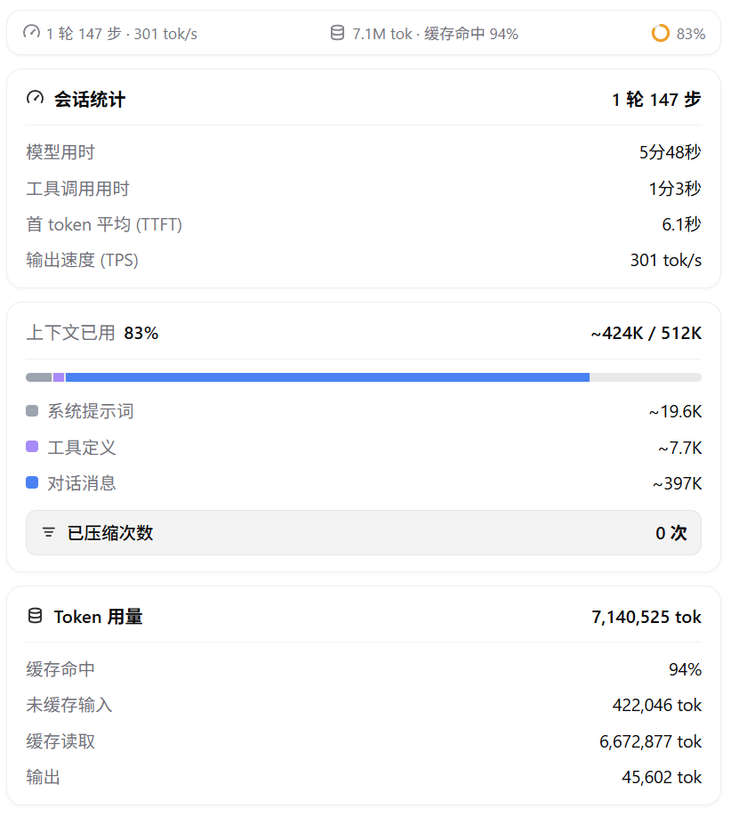
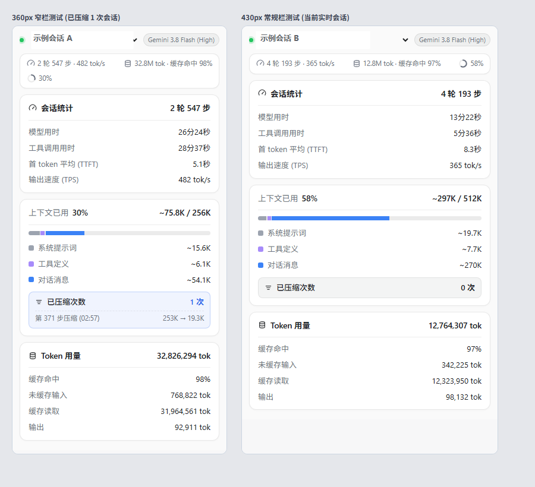

# 会话统计 · Session Monitor

[](LICENSE)
[](plugin.json)
[](#兼容性)
[](https://github.com/QingYi625/session-monitor/releases/tag/v1.0.0)

一个原生 **Antigravity** 插件：通过 Sidecar 在右侧辅助面板（Auxiliary Pane）里实时展示当前对话的运行指标——轮数、步数、模型与工具耗时、首 token 平均耗时、输出速度、Token 缓存命中、上下文构成，以及上下文压缩次数。

所有数据都在本地读取，不联网、不上传、只读，不会修改任何会话记录。



## 功能

### 顶部概览

一眼看到当前会话的轮数 / 步数、累计 Token 与缓存命中率、上下文占用百分比。

### 会话统计

- **轮数 / 步数**：用户与模型的对话轮次，以及规划器执行的步骤总数
- **模型用时**：模型生成响应累计耗时
- **工具调用用时**：工具调用累计耗时
- **首 token 平均（TTFT）**：首次输出 token 的平均等待时间，衡量响应启动速度
- **输出速度（TPS）**：生成阶段平均每秒输出 token 数

### 上下文已用

- **占用比例与窗口上限**：例如 `~424K / 512K`、`83%`
- **构成拆解**：系统提示词、工具定义、对话消息各自占用的 token
- **已压缩次数**：上下文被压缩（compaction）的次数；展开后可查看每次压缩前后的 token 变化与时间点

### Token 用量

- **总 Token**、**缓存命中率**
- **未缓存输入**、**缓存读取**、**输出** 各自的 token 明细

### 交互

- 每 **1.5 秒**自动刷新，数据变化时才更新界面
- 顶部下拉可在最近的会话之间切换，面板默认绑定当前激活的对话
- 窄侧栏（约 360px）与常规侧栏（约 430px）均已适配

## 截图

面板全景（单次会话）：


宽窄布局与压缩记录：



## 安装

### 前置条件

- Antigravity 桌面端（带 Sidecar / 辅助面板能力）
- 本地已有至少一次对话记录，插件才会显示数据

### 方式一：放入插件目录（推荐）

把整个 `session-monitor` 文件夹放到 Antigravity 的插件目录：

```powershell
# Windows
Copy-Item -Recurse -Force .\session-monitor "$env:USERPROFILE\.gemini\config\plugins\session-monitor"
```

```bash
# macOS / Linux
cp -R ./session-monitor ~/.gemini/config/plugins/session-monitor
```

目录结构必须保持 `plugin.json` 位于文件夹根目录：

```
~/.gemini/config/plugins/session-monitor/
├── plugin.json
├── assets/
├── sidecars/
└── skills/
```

### 方式二：下载 Release 包

到 [Releases](https://github.com/QingYi625/session-monitor/releases) 下载最新的 `session-monitor-v1.0.0.zip`，解压后把 `session-monitor` 文件夹放到插件目录即可，不需要 Git。

### 方式三：从仓库克隆

```bash
git clone https://github.com/QingYi625/session-monitor.git \
  ~/.gemini/config/plugins/session-monitor
```

### 启用

1. 完全退出并重新启动 Antigravity（Sidecar 在启动时加载插件清单）。
2. 打开任意对话，点击聊天窗口右上角的 **`+`** 菜单，选择 **会话统计**。
3. 面板会绑定当前对话并在右侧辅助面板中开始刷新。

如果菜单中暂时没有出现入口，可先重新加载窗口，或在对话中粘贴下面的胶囊链接打开：

```
[会话统计](sidecar://session-monitor/stats_panel/)
```

## 使用

| 操作 | 说明 |
| --- | --- |
| 打开面板 | 右上角 `+` 菜单 → 会话统计，或点击 `sidecar://` 胶囊链接 |
| 切换会话 | 面板顶部的会话下拉，选择最近对话 |
| 查看压缩明细 | 展开「已压缩次数」区域 |
| 停止刷新 | 关闭辅助面板即可，Sidecar 不会在前台常驻占用资源 |

## 指标口径

| 指标 | 含义 | 数据来源 |
| --- | --- | --- |
| 轮数 | 用户输入与模型响应的对话轮次 | 会话数据库中的用户输入 / 规划器响应步骤 |
| 步数 | 规划器执行的步骤总数（含工具调用） | 会话数据库步骤记录 |
| 模型用时 | 模型生成阶段累计耗时 | 步骤时间戳差值 |
| 工具调用用时 | 工具执行阶段累计耗时 | 工具调用步骤时间戳 |
| TTFT | 首次输出 token 的平均等待时间 | 生成开始到首个输出 token 的时间 |
| TPS | 生成阶段平均每秒输出 token | 输出 token 数 / 生成耗时 |
| 上下文已用 | 当前上下文体量 / 模型窗口上限 | 提供方返回的 usage 与模型配置 |
| 构成拆解 | 系统提示词、工具定义、对话消息的 token 占比 | 请求负载分段统计 |
| 已压缩次数 | 上下文压缩（compaction）发生次数 | 会话检查点步骤 |
| 缓存命中 | 命中缓存的输入 token 比例 | usage 中的 cached / cache-read 字段 |

> 说明：不同模型、不同版本 Antigravity 返回的字段可能存在差异，缺失的指标会显示为 `—` 或 `0`，不代表请求失败。

## 工作方式

```
Antigravity 会话数据库 (~/.gemini/antigravity/conversations/<id>.db)
        │  (只读，SQLite / node:sqlite)
        ▼
sidecars/stats_panel/parser.mjs  ──►  聚合成 stats 对象
        │
        ▼
main.mjs (Sidecar HTTP)  ──GET /api/stats──►  public/app.js (每 1.5s 轮询)
        │                                        │
        └──────────── 静态页面 ───────────────────┘
```

- **主数据源**：`<appData>/conversations/<conversationId>.db`（通过 Node 内置 `node:sqlite` 读取）
- **回退数据源**：`<appData>/brain/<conversationId>/.system_generated/logs/transcript_full.jsonl`
- **数据目录发现**：优先使用环境变量 `ANTIGRAVITY_EXECUTABLE_DATA_DIR`，否则扫描 `~/.gemini/*` 下的 Antigravity 数据目录
- **接口**：`GET /api/stats?conversationId=<id>`，支持 `etag` 协商，无变化时返回 `unchanged: true`，避免重复渲染
- **前端**：原生 HTML/CSS/JS，无框架、无构建步骤、无外部 npm 依赖

## 目录结构

```
session-monitor/
├── plugin.json                     # 插件元数据（名称、版本、入口、建议提示词）
├── assets/
│   ├── logo.svg                    # 插件图标
│   ├── screenshot-panel.png        # 面板截图
│   └── screenshot-layouts.png      # 宽窄布局截图
├── skills/
│   └── session-monitor/
│       └── SKILL.md                # 供 Agent 调用的技能说明
└── sidecars/
    └── stats_panel/
        ├── sidecar.json            # Sidecar 注册信息（命令、重启策略、辅助面板入口）
        ├── main.mjs                # HTTP 服务与 /api/stats
        ├── parser.mjs              # 会话数据库只读解析与指标聚合
        ├── package.json
        └── public/
            ├── index.html          # 面板结构
            ├── styles.css          # 样式
            └── app.js              # 轮询、渲染与交互
```

## 本地开发

插件运行在 Antigravity 提供的 Sidecar 运行时里，依赖 `sidecar_sdk` 与 Node 内置模块。

- **Node.js**：22.5 及以上（`node:sqlite` 需要）
- **外部依赖**：无。`package.json` 仅声明模块类型与名称

调试思路：

1. 修改 `public/` 下的文件后，刷新辅助面板即可看到效果。
2. 修改 `parser.mjs` / `main.mjs` 后，需要重启 Sidecar（或重启 Antigravity）。
3. 想确认解析结果，可直接调用 `getConversationStats(<conversationId>)` 观察返回的 `stats` 字段。

## 隐私与安全

- **只读**：只读取会话数据库与转录日志，不写入、不删除、不迁移任何会话数据
- **本地**：不发起任何网络请求，数据不会离开你的电脑
- **无凭证**：不读取、不存储任何账号、Token 或 API Key
- **最小权限**：`sidecar.json` 中 `allows_user_interactions` 为 `false`，面板不主动弹窗打扰

## 常见问题

**面板打开后没有数据？**
确认至少完成过一次对话；若仍为空，检查 `~/.gemini/antigravity/conversations/` 下是否存在 `.db` 文件，以及 Antigravity 版本是否支持 Sidecar 辅助面板。

**数据目录不在默认位置？**
设置环境变量 `ANTIGRAVITY_EXECUTABLE_DATA_DIR` 指向 Antigravity 的可执行数据目录，插件会据此定位 `conversations/` 与 `brain/`。

**「已压缩次数」一直是 0？**
表示当前会话尚未触发上下文压缩；长对话触发后会自动计数并生成记录。

**数字和官方界面不完全一致？**
统计基于本地会话记录的步骤时间戳与 usage 字段聚合，口径可能与官方 UI 略有差异；缺失字段会显示为 `—`。

## 兼容性

- 目标宿主：Antigravity（Sidecar + Auxiliary Pane）
- 系统：Windows / macOS / Linux
- 面板宽度：约 360px 起可用，430px 及以上为完整布局

## English

**Session Monitor** is a native Antigravity plugin that shows live session metrics in the Auxiliary Pane: turns and steps, model/tool durations, average time-to-first-token, output tokens per second, token cache hit rate, context breakdown, and compaction count.

Everything is read from the local conversation database in a read-only fashion — no network access, no telemetry, no credentials. Install by copying this folder into `~/.gemini/config/plugins/session-monitor`, restart Antigravity, then open **会话统计** from the `+` menu.

## 更新日志

见 [CHANGELOG.md](CHANGELOG.md)。

## 反馈

- 问题反馈：[新建 Bug 报告](https://github.com/QingYi625/session-monitor/issues/new?template=bug_report.yml)
- 功能建议：[新建功能建议](https://github.com/QingYi625/session-monitor/issues/new?template=feature_request.yml)
- 提交前请先看「常见问题」，并避免在截图或日志中暴露账号、API Key 等敏感信息。

## 许可证

[MIT](LICENSE) © 2026 QingYi625
